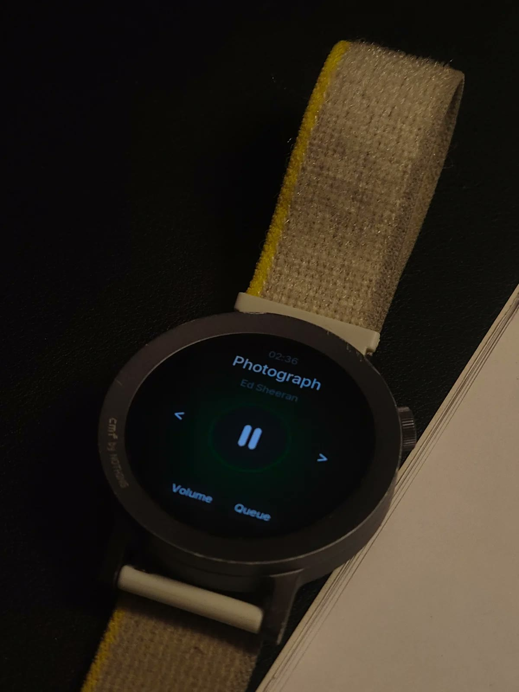
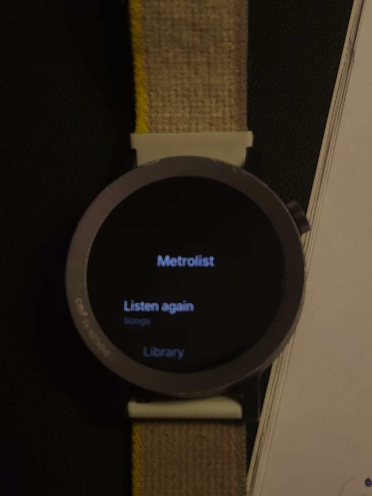
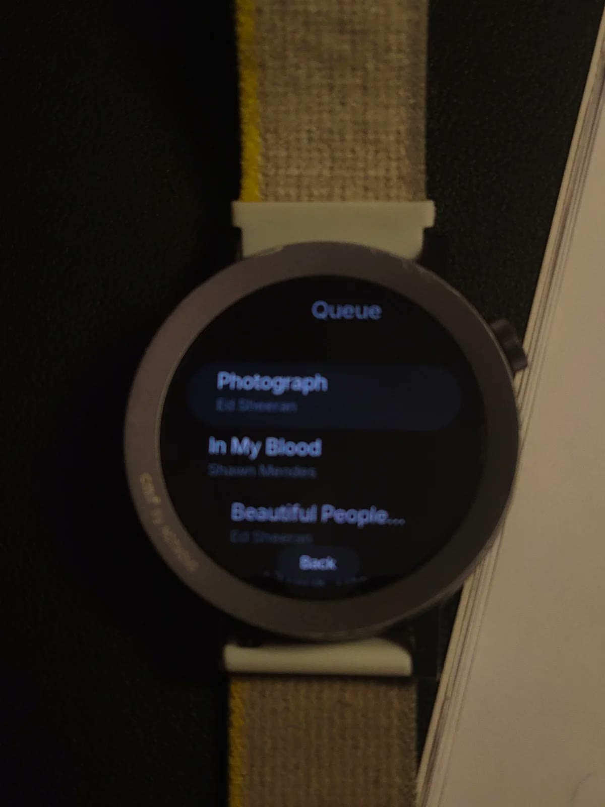

# Metrolist for the CMF Watch Pro 2

**Your YouTube Music library on your wrist, and a player that runs the phone.** Browse what you actually have —
downloads, playlists, albums, artists — start a song from the watch, then control it without pulling the phone out:
play/pause, previous/next, the phone's volume and its queue, with the artwork's colour glowing behind the button.

[**Download the Android app (APK)**](https://github.com/krtkygpta/metrolist/releases/latest) ·
[watch app package](https://github.com/krtkygpta/metrolist/releases/latest) ·
[how it talks to the phone](apps/metrolist/ANDROID_COMPANION.md)



No account, sign-in, cookie, token, track URL or file path ever crosses the Bluetooth link — only titles, artists, one
16-bit colour and the play state. The audio always plays on the phone; the watch is a remote with a library on it.

## What you get

- **A player that matches the record.** The sleeve's dominant colour glows behind the play button in concentric bands
  (the watch's LVGL has no gradient), the same colour fills the progress ring, and the controls are see-through so the
  glow reads through them. Long titles scroll round instead of being cut off.
- **Skip, pause, resume from the wrist.** Previous / play-pause / next, plus the phone's own volume and queue: a capsule
  that follows the phone's volume (drag it or turn the crown) and up to 20 queue entries you can jump to.
- **A library that is really yours.** The watch lists the categories the phone's Metrolist has content for, and opens
  downloads, playlists, albums and artists; empty shelves such as Quick picks stay off the watch. Picking a song
  starts a queue from there.
- **A page next to the watch face.** Long press the app's row in Apps → Add page, and the player sits one swipe from
  the face with no browsing around it.
- **One pairing, nothing disturbed.** The link reuses the watch's existing bond through the app channel, so Nothing X
  keeps working and there is no second "Paired" popup.

## Screenshots

| The player | Library | The queue |
|---|---|---|
|  |  |  |

## Install

1. **On the phone** — download the APK from the [latest release](https://github.com/krtkygpta/metrolist/releases/latest)
   and install it. The build is `com.metrolist.music.debug`, so it installs next to a release Metrolist instead of
   replacing it. It is debug-signed: enable "install unknown apps" for your browser or file manager, and expect Play
   Protect to ask once. Sign in to YouTube Music inside the app.
2. **On the phone** — open **Settings → Watch**, turn the watch link on, and use **Install Metrolist on watch** to
   push the watch app through the same Bluetooth link.
3. **On the watch** — open Metrolist from the Apps row. The player is also available as a page (long press its row →
   Add page).

The release page also carries the standalone `.wp2app`, if you would rather install the watch half with the App Loader
from a PC.

## Requirements

- A CMF Watch Pro 2 with the [FMC patched firmware and App Loader](https://fmc.freethinkel.dev/firmware): the channel
  key needs a stub and loader from 2026-11-13 or newer, and this app (it owns Back, pages the controller sideways and
  draws with the stock LVGL widgets) a loader from 2026-11-16 or newer. Stock firmware has no app channel at all.
- Android 9 or newer on the phone, with the Nothing X app still installed — the link rides the existing bond.
- One central at a time: while the phone is connected, no other device (a Mac, say) can hold the watch.

## What's in this repository

- `apps/metrolist/` — the watch app, the same files as the
  [`metrolist-companion` branch of the FMC apps repository](https://github.com/fmctools/apps), which is where it can
  be merged into the FMC store. `store.toml`, `store.md` and `shots/` are its store listing, and
  `ANDROID_COMPANION.md` is the watch-phone protocol contract.
- `android/` — the Android companion: [MetrolistGroup/Metrolist](https://github.com/MetrolistGroup/Metrolist) plus the
  watch link (Settings → Watch, `com.metrolist.android.watch`). It owns the account, the downloads, the library and
  the player; the watch only names a category, an item and a command.

## Build the watch app from source

Toolchain: [Rust](https://rustup.rs) with `rustup target add thumbv7em-none-eabi` and
`rustup component add llvm-tools`, [uv](https://docs.astral.sh/uv/), [resvg](https://github.com/linebender/resvg),
`make`, and a C linker.

```bash
git clone https://github.com/krtkygpta/metrolist
cd metrolist
make sdk                       # fetch cmf-watch-sdk at the pinned commit into .sdk/wp2-apps
make test APP=metrolist        # host tests, including every LVGL batch
make build APP=metrolist       # target/metrolist.wp2app
```

Then install `target/metrolist.wp2app` with the App Loader.

## Build the Android app

Metrolist is Kotlin Multiplatform and the BLE link is Android-only, so the app needs upstream's toolchain: JDK 21,
Android SDK platform `android-37.1`, NDK `30.0.16248370`, CMake `4.1.2`, and the `metroproto` and `libopus` sources
(this repository has them in place, without their `.git`):

```bash
cd android
./gradlew :androidApp:assembleDebug              # androidApp/build/outputs/apk/debug/androidApp-debug.apk
./gradlew :androidApp:testDebugUnitTest --tests 'com.metrolist.android.watch.*'
```

## Before calling it shipped

- Nothing X and this app together on each supported vendor/version: no pairing popup, both keep notifications, the
  channel survives screen-off and a service restart. `connectGatt` next to Nothing X is still untested on Android.
- Two accounts: the watch must get nothing from the other one.
- The watch and the phone are one central at a time, so no second device (a Mac, say) while the phone is connected.

## Licences

`apps/` is MIT, like the rest of the FMC apps repository. `android/` is GPL-3.0, inherited from Metrolist; see
`android/LICENSE`.
